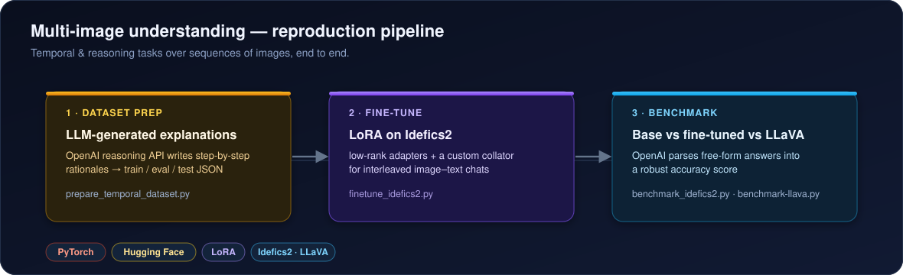

<div align="center">

<h1>MMIU — Multi-Image Understanding Pipeline</h1>

<p><b>Dataset construction → LoRA fine-tuning → benchmarking for multi-image vision-language models</b></p>

<p>
  
  
  
  
  
  <a href="LICENSE"></a>
</p>

</div>

An end-to-end, reproducible pipeline for **temporal and reasoning tasks over sequences of images** — the kind of multi-image understanding where a model must compare several pictures and explain an ordering or relationship. It covers the full loop: building an instruction dataset with rationales, fine-tuning **Idefics2** with LoRA, and benchmarking base vs fine-tuned models against **LLaVA**.

<p align="center">
  
</p>

## Pipeline

1. **Dataset preparation** — `prepare_temporal_dataset.py` uses the OpenAI reasoning API to attach step-by-step explanations to a temporal-ordering dataset, emitting `train.json`, `eval.json` and `test.json`.
2. **Fine-tuning** — `finetune_idefics2.py` adapts Idefics2 with LoRA adapters and a custom data collator for interleaved image–text conversations.
3. **Benchmarking** — `benchmark_idefics2.py` and `benchmark-llava.py` evaluate base and fine-tuned models on the multi-image tasks, using an OpenAI model to parse free-form answers into a robust accuracy figure.

## Setup

```bash
# 1. Clone
git clone https://github.com/sserkanakin/multimodal-understanding-reproduction-pipeline.git
cd multimodal-understanding-reproduction-pipeline

# 2. Create the environment (installs requirements.txt via pip)
conda env create -f environment.yml
conda activate tune

# 3. Add your OpenAI key (used for dataset rationales + answer parsing)
echo 'OPENAI_API_KEY="sk-..."' > src/.env
```

## Run it

```bash
# 1 · build the dataset with generated explanations
python src/scripts/prepare_temporal_dataset.py

# 2 · fine-tune Idefics2 with LoRA
python src/scripts/finetune_idefics2.py

# 3 · benchmark (base + fine-tuned, and LLaVA)
python src/scripts/benchmark_idefics2.py
python src/scripts/benchmark-llava.py
```

## Layout

```
.
├── environment.yml / requirements.txt
├── data/
│   ├── to-data.json                 # source temporal-ordering data
│   └── finetune_data/               # generated train.json / eval.json / test.json
└── src/scripts/
    ├── prepare_temporal_dataset.py  # OpenAI-assisted dataset construction
    ├── finetune_idefics2.py         # LoRA fine-tuning of Idefics2
    ├── benchmark_idefics2.py        # evaluate Idefics2 (base & fine-tuned)
    └── benchmark-llava.py           # evaluate LLaVA
```

> A GPU is recommended for fine-tuning and inference. The OpenAI key is only needed for dataset construction and answer parsing — model training/inference run locally.

## License

Released under the [MIT License](LICENSE). Idefics2 and LLaVA are governed by their own model licenses.
